<!-- Shaurya Kansal — animated profile README -->

<picture>
  <source media="(prefers-reduced-motion: reduce)" srcset="assets/hero.svg"/>
  
</picture>

<picture>
  <source media="(prefers-reduced-motion: reduce)" srcset="assets/contributions-forest.svg"/>
  
</picture>

<picture>
  <source media="(prefers-reduced-motion: reduce)" srcset="assets/cities.svg"/>
  
</picture>

<picture>
  <source media="(prefers-reduced-motion: reduce)" srcset="assets/planets.svg"/>
  
</picture>

<picture>
  <source media="(prefers-reduced-motion: reduce)" srcset="assets/orbital-garden.svg"/>
  
</picture>

---

**Links**

[GitHub](https://github.com/shauryacuriosity)

