<table align="center" border="0" cellpadding="0" cellspacing="0" role="presentation">
<tr><td align="center" style="line-height:0"></td></tr>
<tr><td align="center" style="line-height:0"></td></tr>
<tr><td align="center" style="line-height:0"></td></tr>
<tr><td align="center" style="line-height:0"></td></tr>
<tr><td align="center" style="line-height:0"></td></tr>
</table>